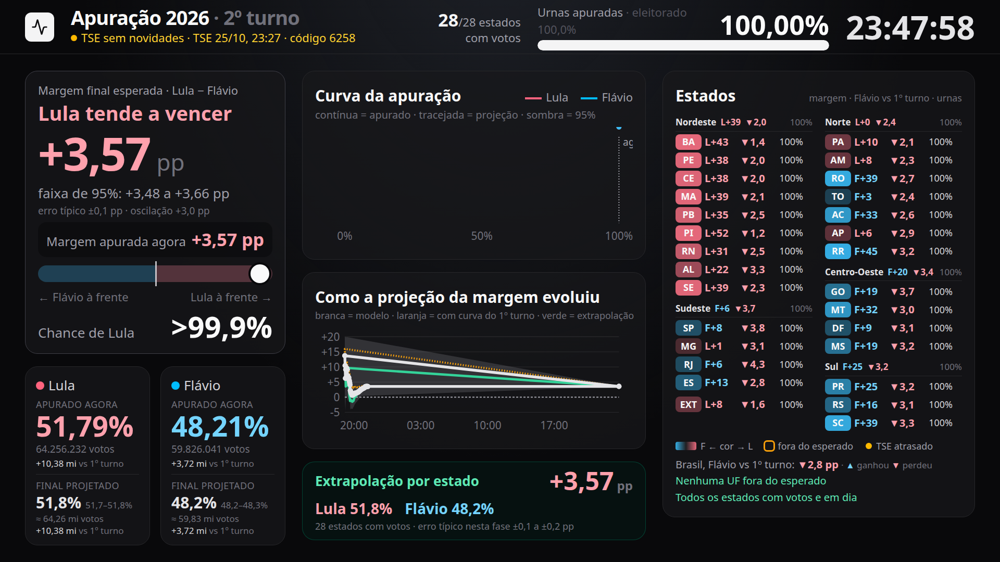
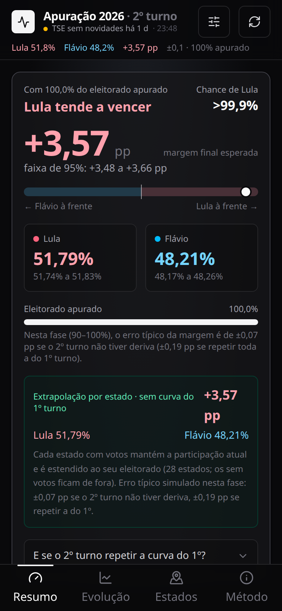

# Eleições 2026: live tally and forecast

A live dashboard for Brazil's 2026 presidential election. It reads the official result files
published by the electoral court (TSE) every 30 seconds and forecasts the final result while
the votes are still being counted, with a 95% confidence range and alerts for states that
behave differently from what the model expects.

It was built as a personal project for election night, mobile-first, with a TV mode for a
big screen. The interface and the internal documentation are in Portuguese.



<p align="center">
  
</p>

## How well did it work?

The model was calibrated on the first round (Oct 4) and evaluated on the runoff (Oct 25)
against the final count (99.8% counted, final margin +3.56 pp), using 77 snapshots taken
during the night. Values are the error of the forecast final margin, in percentage points
(root mean square error):

| Votes counted | Simple extrapolation | Calibrated model | Model without drift | 95% range contained the final result |
|---|---|---|---|---|
| 10% – 30% | 2.84 | 5.98 | 4.09 | 100% |
| 30% – 60% | 4.12 | 2.72 | 3.25 | 100% |
| 60% – 90% | 1.54 | **0.12** | 1.32 | 100% |
| 90% – 99% | 0.31 | **0.06** | 0.40 | 100% |

With 60% to 90% of the votes counted, the calibrated model missed the final margin by about
0.1 pp, while simple extrapolation missed by 1.5 pp. In the early phase (10% – 30%) the
model did worse than simple extrapolation, which is why the dashboard always shows both.
Reproduce with `python3 predicao-2turno/avaliar.py`.

## How the forecast works

1. **Final valid votes per state:** valid votes counted so far divided by the share of the
   electorate already counted.
2. **First-round drift:** in the first round, the leading candidate's share in each state
   moved in a consistent direction as counting progressed. The model can add that
   correction, or leave it out ("without drift") if the runoff doesn't repeat the pattern.
3. **Per-state estimate:** blends the observed share with a prior (first-round result plus
   the national swing measured live). The observed data gets more weight as the state's
   count advances, using the per-state error measured in the first round.
4. **National result:** states weighted by their estimated final valid votes.
5. **95% range:** per-state variance, a correlation factor between states, the uncertainty
   of the national swing and the uncertainty about the drift.
6. **Unexpected states:** each state's deviation becomes a z-score; an alert fires only if
   it persists in 3 of the last 4 updates, to filter counting noise.

Full method, studies and limitations (in Portuguese): [`predicao-2turno/README.md`](predicao-2turno/README.md).

## Repository layout

| Folder | Contents |
|---|---|
| [`apuracao-2026/`](apuracao-2026/) | Web app: React, TypeScript, Vite and Tailwind. A small server plugin proxies the TSE files and records snapshots. |
| [`predicao-2turno/`](predicao-2turno/) | Model, calibration studies, simulation and post-election evaluation, in Python. `apuracao-2026/src/model.ts` is a port of `modelo.py`. |
| [`predicao-2turno/snapshots/`](predicao-2turno/snapshots/) | Snapshots of the TSE result files recorded during both rounds. |
| [`dados/`](dados/) | First-round TSE data per state used for calibration. |

## Running it

```sh
cd apuracao-2026
npm install
npm run dev        # http://localhost:5173 · TV mode at /#tv
```

```sh
cd predicao-2turno
python3 modelo.py    # forecast from the latest runoff snapshot
python3 avaliar.py   # error and coverage against the final result
```

## How it was built

Developed with AI coding agents (Claude Code and Codex), working from written
specifications and checking each model change against the first-round data before using
it on election night.

## Disclaimer

Independent project, not affiliated with the TSE. The data comes from the TSE's public
result files. The "chance of leading" describes the model, not the official result.

## License

[MIT](LICENSE) © 2026 Diego Alencar Cavalcante
